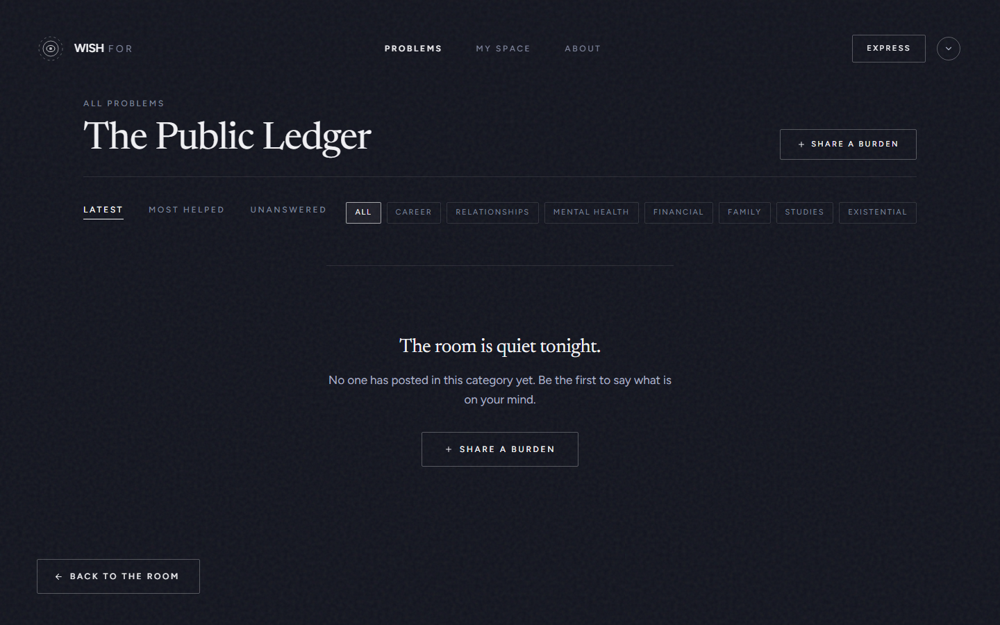
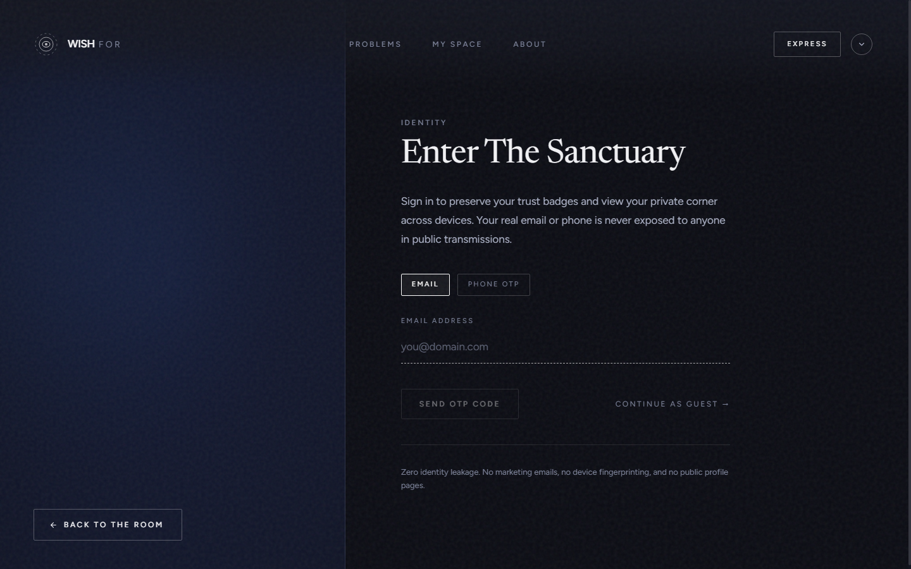
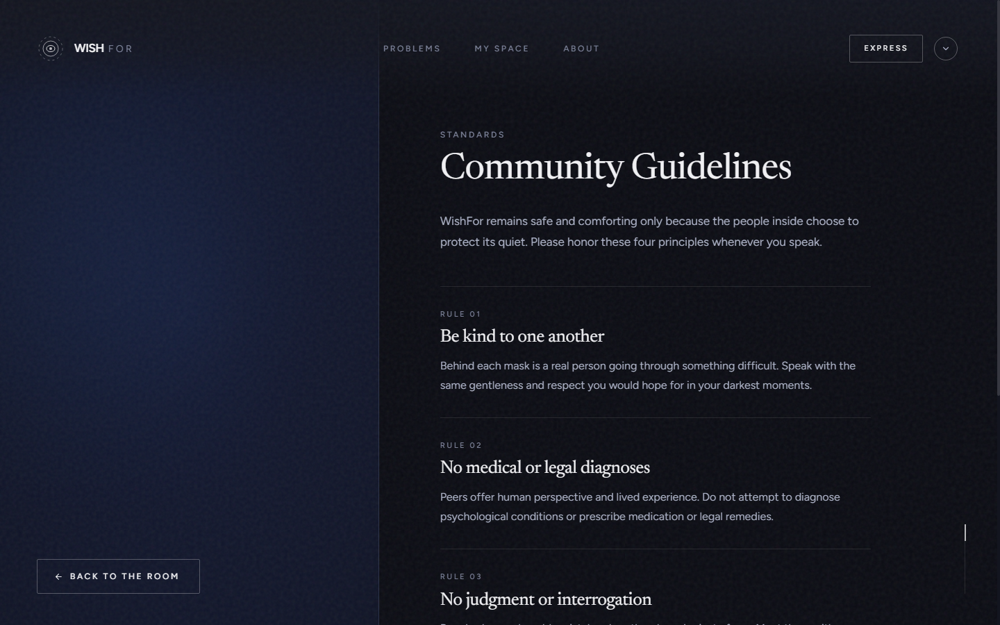
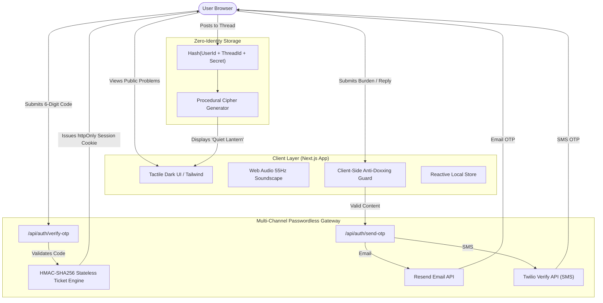

# Wishfor // Anonymous Peer Sanctuary

<div align="center">

```
  ██     ██  ██  ███████  ██   ██  ███████   ██████   ██████  
  ██     ██  ██  ██       ██   ██  ██       ██    ██  ██   ██ 
  ██  █  ██  ██  ███████  ███████  █████    ██    ██  ██████  
  ██ ███ ██  ██       ██  ██   ██  ██       ██    ██  ██   ██ 
   ███ ███   ██  ███████  ██   ██  ██        ██████   ██   ██ 
```

**"Say what is on your mind. No one will know it is you."**

An anonymous peer-support sanctuary where individuals share personal struggles freely and receive thoughtful advice from kind peers under rotating cipher masks. Designed with a strict zero-identity-leakage architecture, passwordless dual-channel authentication, real-time crisis safety protocols, and a tactile dark aesthetic.

[](https://nextjs.org/)
[](https://www.typescriptlang.org/)
[](https://tailwindcss.com/)
[](https://www.twilio.com/verify)
[](https://resend.com/)
[](#-security--privacy-guarantees)
[](LICENSE)

</div>

---

## 📑 Table of Contents

- [Overview & Vision](#-overview--vision)
- [Visual Walkthrough & Core System Sections](#-visual-walkthrough--core-system-sections)
  - [1. The Sanctuary Entrance (`/`)](#1-the-sanctuary-entrance-)
  - [2. The Public Problems Ledger (`/problems`)](#2-the-public-problems-ledger-problems)
  - [3. Problem Detail & Rotating Mask Dialogue (`/problems/[id]`)](#3-problem-detail--rotating-mask-dialogue-problemsid)
  - [4. Transmission Composer (`/share`)](#4-transmission-composer-share)
  - [5. Member Profile & Private Corner (`/my-space`)](#5-member-profile--private-corner-my-space)
  - [6. Multi-Channel Passwordless Authentication (`/auth`)](#6-multi-channel-passwordless-authentication-auth)
  - [7. Community Codex & Philosophy (`/guidelines` & `/about`)](#7-community-codex--philosophy-guidelines--about)
- [System Architecture & Privacy Model](#-system-architecture--privacy-model)
- [Technology Stack](#-technology-stack)
- [Directory Structure](#-directory-structure)
- [Environment Configuration](#-environment-configuration)
- [Installation & Local Setup](#-installation--local-setup)
- [Automated Backend Verification](#-automated-backend-verification)
- [Security & Privacy Guarantees](#-security--privacy-guarantees)
- [License](#-license)

---

## 👁️ Overview & Vision

Modern social networks link every post to a permanent profile, follower count, or social graph. When honesty carries emotional, social, or professional risk, people quietly swallow their burdens rather than speaking up.

**Wishfor** provides an anonymous digital peer sanctuary that discards vanity metrics, user profiles, public feeds, and tracking scripts:

- **Public Global Reading**: Anyone worldwide can read and gain perspective from community problems without creating an account.
- **Protected Interaction**: Replying and asking questions requires passwordless verification (Email or SMS OTP) to prevent spam, automated bots, and bad-faith behavior.
- **Rotating Anonymity**: Real names, emails, phone numbers, and IP addresses are never shown. Users communicate under procedurally generated cipher masks (*e.g., Quiet Lantern, Silver Moth, Midnight Kite*).
- **Authorship Continuity**: When a member signs in with the same email or phone number, their past questions, replies, and earned trust score are preserved in their private corner without exposing their identity to peers.

---

## 🖼️ Visual Walkthrough & Core System Sections

### 1. The Sanctuary Entrance (`/`)

The entry point of Wishfor presents an atmospheric, distraction-free environment that introduces the core principles of the sanctuary.


#### Highlights
- **Editorial Typography**: High-contrast, minimal layout inviting honest disclosure without social pressure.
- **Category Constellation**: Visual access to six primary emotional domains: *Career, Personal, Relationships, Family, Studies, Financial, Mental Health,* and *Existential*.
- **Procedural Soundscape Engine (`src/lib/soundscape.ts`)**: Built-in Web Audio API synthesizer generating a subtle 55Hz ambient drone with tape-flutter modulation, toggleable via the header control.
- **Direct Navigation**: Fast access to post a new dilemma (`+ SAY WHAT'S ON YOUR MIND`) or explore the archive (`BROWSE THE PROBLEMS`).

---

### 2. The Public Problems Ledger (`/problems`)

The public directory where community dilemmas and peer responses are organized into readable, searchable streams.



#### Highlights
- **Open Global Access**: Anyone can read and gain perspective without an account.
- **Real-Time Category Filters**: Filter by *All, Career, Relationships, Mental Health, Financial, Family, Studies,* or *Existential*.
- **Status Tabs**: Instant switching between:
  - `LATEST`: Most recent transmissions across all categories.
  - `MOST HELPED`: Problems where peers provided answers marked as helpful by the author.
  - `UNANSWERED`: Transmissions awaiting their first kind reply.
- **Smooth Page Transitions**: Editorial `page-fade-drift` route transition and responsive mobile reflow.

---

### 3. Problem Detail & Rotating Mask Dialogue (`/problems/[id]`)

The thread view where authentic peer dialogue takes place under cryptographic anonymity.

```
+---------------------------------------------------------------------------------+
|  PROBLEM THREAD #c7f2                                                           |
|                                                                                 |
|  [ASKER] Quiet Lantern · 3 hours ago · Career                                   |
|  "I was passed over for a promotion I worked two years for, and my manager..." |
|                                                                                 |
|  -----------------------------------------------------------------------------  |
|                                                                                 |
|  Silver Moth · 2 hours ago                                                      |
|  "I went through this exact same betrayal in 2022. Here is what I learned..."   |
|  [★ HELPED ME MOST (+5 PTS)]  [♡ RESONANCE: 14]                                 |
|                                                                                 |
|  Amber Fox · 45 minutes ago                                                     |
|  "Give yourself 48 hours before having that one-on-one. Write your talking..."  |
|  [♡ RESONANCE: 6]                                                               |
+---------------------------------------------------------------------------------+
```

#### Highlights
- **Cryptographic Per-Thread Salting (`src/lib/anonymity.ts`)**: Every participant is assigned a unique cipher pseudonym derived from `hash(userId + threadId)`. A user commenting as *Silver Moth* in one thread will appear as *Quiet River* in another, eliminating cross-thread tracking.
- **Consistent Asker Badge**: The original poster is labeled with a distinct `[ASKER]` badge throughout their thread so peers always know who authored the dilemma.
- **Anti-Self-Reply Protection**: Authors cannot reply to their own questions as another peer, preventing astroturfing and false consensus.
- **"This Helped Me Most" Recognition**: The author can designate the single most helpful peer reply, awarding the author **+5 Trust Points** and a permanent gold badge.
- **Resonance Feedback**: Kind reactions allow readers to acknowledge helpful advice without noisy comment threads.

---

### 4. Transmission Composer (`/share`)

A focused writing space for formulating questions and burdens safely.


#### Highlights
- **Distraction-Free Interface**: Clean textarea with 2,000-character limit, category selector, and optional title field.
- **Automated Anti-Doxxing Guard (`src/lib/safety.ts`)**: Scans text in real time to catch accidental inclusion of personal phone numbers, email addresses, or social media handles before transmission.
- **Proactive Distress Detection**: Scans transmissions for acute emotional crisis keywords. When distress is detected, a verified crisis hotline card immediately appears above the form:
  - **988 Suicide & Crisis Lifeline**: Dial `988` (US & Canada, 24/7)
  - **Tele-MANAS**: Dial `14416` (India, 24/7 Toll-Free)
  - **Samaritans**: Dial `116 123` (UK & Ireland)
  - **Crisis Text Line**: Text `HOME` to `741741`
  - **International Directory**: [findahelpline.com](https://findahelpline.com)

---

### 5. Member Profile & Private Corner (`/my-space`)

A private dashboard accessible only to the authenticated user, tracking their sanctuary activity and reputation.


#### Highlights
- **Current Session Mask**: Shows your active identity mask and verification status (`UNVERIFIED GUEST` or `VERIFIED MEMBER`).
- **Reputation & Trust Level**:
  - `Newcomer` (0 - 4 pts)
  - `Contributor` (5 - 19 pts)
  - `Pillar of Sanctuary` (20+ pts)
- **Organized Dossier Tabs**:
  - `MY QUESTIONS`: Every problem you have authored, with live reply counters.
  - `MY CONTRIBUTIONS`: Every thoughtful suggestion you provided to peers across the platform.
  - `SAVED`: Bookmarked dilemmas stored for later reference.
- **Session Decoupling**: Logging out terminates active session tokens without deleting your community contributions. Signing back in with the same email or phone immediately restores your full history.

---

### 6. Multi-Channel Passwordless Authentication (`/auth`)

A secure, zero-password authentication gateway supporting transactional Email OTP and carrier-grade SMS OTP.



#### Highlights
- **Email OTP via Resend API**: Sends a 6-digit verification code using transactional email templates with zero spam-folder routing.
- **SMS OTP via Twilio Verify API**: Uses Twilio's specialized Verify Service with pre-approved international carrier templates, bypassing carrier template blocks (such as Indian DLT restrictions) that stop standard SMS APIs.
- **50+ Country Code Selector (`src/lib/countryCodes.ts`)**: Integrated dial-code dropdown with instant flag search and automatic E.164 phone formatting.
- **Cryptographic Stateless Tickets (`src/lib/serverAuth.ts`)**: Generates HMAC-signed verification tickets stored in secure `httpOnly` cookies:
  - Survives serverless cold starts and container restarts on Vercel, Render, and AWS.
  - 60-second cooldown timer on resend actions to prevent abuse.
  - Strict hourly rate limits per identifier.
- **Timing-Safe Checks**: Validates tickets using `crypto.timingSafeEqual` to eliminate timing side-channel vulnerabilities.

---

### 7. Community Codex & Philosophy (`/guidelines` & `/about`)

Clear documentation outlining the platform's expectations and ethics.

<p align="center">
  
  
</p>

#### Highlights
- **The Sanctuary Codex**: Core commitments: non-judgment, constructive peer presence, zero commercial advertising, and zero retaliation.
- **Peer Support vs. Medical Advice**: Explicit boundary stating that Wishfor is an empathetic listening collective, not a licensed medical or psychiatric provider.
- **Community Moderation Desk (`/moderation`)**: Review reported transmissions, inspect flags, and maintain a safe environment without invasive surveillance.

---

## 🔒 System Architecture & Privacy Model



### Identity Anonymity Salting
To guarantee that user identities cannot be mapped across different problem threads:

$$\text{Seed} = \text{HMAC-SHA256}(\text{UserId} \parallel \text{ThreadId}, \text{Salt})$$

1. **Deterministic within thread**: Within a single problem thread, all responses from the same user share the same mask.
2. **Unlinkable across threads**: In another thread, the exact same user receives a mathematically uncorrelated mask.
3. **No identity leakage**: Real email addresses and phone numbers are never included in API responses or public stores.

---

## 🛠️ Technology Stack

| Layer | Technology | Purpose |
| :--- | :--- | :--- |
| **Framework** | Next.js 14 (App Router) | Server components, route handlers, and static generation |
| **Language** | TypeScript 5 (Strict Mode) | Full type safety across API boundaries and client models |
| **Styling** | Tailwind CSS + PostCSS | Dark-mode design system with fine hairline borders and tactile states |
| **Iconography** | Lucide React | Lightweight SVG icons |
| **Email Gateway** | Resend API | Transactional OTP delivery with high inbox deliverability |
| **SMS Gateway** | Twilio Verify API | Telecom carrier-approved SMS verification templates |
| **Audio Synthesizer**| Web Audio API | Client-side 55Hz ambient drone and tactile click feedback |
| **Security** | Node.js `crypto` | HMAC-SHA256 stateless verification tickets & timing-safe equality |
| **Persistence** | Synchronized Store | Local storage with server cookie session reconciliation |

---

## 📂 Directory Structure

```
Wishfor/
├── public/
│   ├── icon.svg                      # Modern geometric W brand emblem
│   └── manifest.json                 # Web App Manifest
├── screenshots/                      # 1440px desktop & mobile visual assets
│   ├── home_1440.png                 # Sanctuary entrance screenshot
│   ├── problems_1440.png             # Public problems ledger screenshot
│   ├── share_1440.png                # Transmission composer screenshot
│   ├── my_space_1440.png             # Member profile screenshot
│   ├── auth_1440.png                 # Passwordless login/signup screenshot
│   ├── about_1440.png                # Philosophy page screenshot
│   └── guidelines_1440.png           # Community guidelines screenshot
├── scripts/
│   ├── capture_screenshots.js        # Automated multi-resolution capture script
│   └── test_backend.js               # Comprehensive OTP & API test suite
├── src/
│   ├── app/
│   │   ├── api/
│   │   │   ├── auth/
│   │   │   │   ├── send-otp/         # OTP dispatch endpoint
│   │   │   │   ├── resend-otp/       # Rate-limited OTP resend endpoint
│   │   │   │   └── verify-otp/       # OTP & ticket validation endpoint
│   │   │   ├── posts/                # CRUD route handlers for problems
│   │   │   └── replies/              # Route handlers for peer suggestions
│   │   ├── about/                    # Platform origin & philosophy
│   │   ├── auth/                     # Split-screen passwordless login/signup
│   │   ├── guidelines/               # Community rules & safety codex
│   │   ├── moderation/               # Moderation panel for reported content
│   │   ├── my-space/                 # Member profile, contributions & saved posts
│   │   ├── problems/                 # Public problems directory & category filters
│   │   │   └── [id]/                 # Single problem thread & peer conversation
│   │   ├── share/                    # New problem transmission composer
│   │   ├── globals.css               # Design system tokens, keyframes & animations
│   │   ├── layout.tsx                # App root layout with persistent header
│   │   └── page.tsx                  # Landing room experience
│   ├── components/
│   │   ├── AuthModal.tsx             # Interactive modal for inline authentication
│   │   ├── CrisisBanner.tsx          # Real-time crisis hotline card
│   │   ├── Header.tsx                # Header with modern W logo & profile menu
│   │   ├── PersistentNav.tsx         # Floating quick-navigation & room return
│   │   ├── RoomCanvas.tsx            # Ambient category constellation mapping
│   │   └── SplitLayout.tsx           # Reusable split-panel layout with ambient glow
│   ├── lib/
│   │   ├── anonymity.ts              # Deterministic cipher mask generator
│   │   ├── countryCodes.ts           # 50+ international dial codes & flags
│   │   ├── dispatchService.ts        # Unified Resend & Twilio Verify dispatch
│   │   ├── initialData.ts            # Baseline peer problems archive
│   │   ├── safety.ts                 # Real-time crisis & anti-doxxing scanners
│   │   ├── serverAuth.ts             # Cryptographic HMAC tickets & OTP store
│   │   ├── soundscape.ts             # Procedural Web Audio API sound synthesizer
│   │   └── store.ts                  # Client-side community store
│   └── types/
│       └── index.ts                  # Shared domain types & interfaces
├── .env.example                      # Template for environment configuration
├── package.json                      # Project dependencies & scripts
├── tailwind.config.ts                # Tailwind design configuration
└── tsconfig.json                     # TypeScript compilation configuration
```

---

## ⚙️ Environment Configuration

Wishfor runs in development mode without external API keys by printing OTP codes directly to the server terminal. To activate live email and SMS delivery, copy `.env.example` to `.env.local` and configure your credentials:

```bash
cp .env.example .env.local
```

### Environment Variables Reference

```env
# ========================================================
# 1. TRANSACTIONAL EMAIL (Resend)
# Get your API key at https://resend.com
# ========================================================
RESEND_API_KEY=re_your_api_key_here
EMAIL_FROM=WishFor Sanctuary <onboarding@resend.dev>

# ========================================================
# 2. SMS OTP VERIFICATION (Twilio Verify)
# Get credentials at https://www.twilio.com/console
# Create a Verify Service at https://www.twilio.com/console/verify/services
# ========================================================
TWILIO_ACCOUNT_SID=ACyour_account_sid_here
TWILIO_AUTH_TOKEN=your_auth_token_here
TWILIO_PHONE_NUMBER=+1xxxxxxxxxx
TWILIO_VERIFY_SERVICE_SID=VAyour_verify_service_sid_here

# ========================================================
# 3. OPTIONAL MANAGED DATABASE (Supabase)
# ========================================================
# NEXT_PUBLIC_SUPABASE_URL=https://your-project.supabase.co
# NEXT_PUBLIC_SUPABASE_ANON_KEY=your_anon_key_here
```

---

## 💻 Installation & Local Setup

### Prerequisites
- **Node.js**: v18.17.0 or higher
- **Package Manager**: npm, pnpm, or yarn

### 1. Clone the Repository
```bash
git clone https://github.com/your-username/wishfor.git
cd wishfor
```

### 2. Install Dependencies
```bash
npm install
```

### 3. Start Development Server
```bash
npm run dev
```

Open [http://localhost:3000](http://localhost:3000) in your browser.

### 4. Build for Production
```bash
# Type check and build optimized bundle
npm run build

# Start production server
npm run start
```

---

## 🧪 Automated Backend Verification

Wishfor includes an automated backend test suite verifying authentication pipelines, HMAC ticket verification, rate limits, and dispatch handlers:

```bash
node scripts/test_backend.js
```

### What the Test Suite Covers:
- `✓` Rejection of malformed email formats.
- `✓` Rejection of invalid phone numbers (requires 10+ digits).
- `✓` Successful generation of 6-digit OTP codes.
- `✓` Proper delivery of HMAC-signed verification tickets.
- `✓` Enforcement of 60-second resend cooldown timers.
- `✓` Timing-safe validation of correct codes and rejection of altered codes.
- `✓` Live Twilio Verify and Resend dispatch flows.

---

## 🛡️ Security & Privacy Guarantees

1. **Zero Client Fingerprinting**: No canvas fingerprinting, WebRTC IP harvesting, or hardware telemetry scripts.
2. **Encrypted Identity Storage**: Personal phone numbers and email addresses are never returned in public JSON payloads, problem feeds, or reply objects.
3. **Stateless HMAC Sessions**: Session verification tokens are signed using HMAC-SHA256 and evaluated via `crypto.timingSafeEqual`, preventing tampering and side-channel timing attacks.
4. **Isolated Authorship Verification**: Authorship permissions for actions like marking replies as "Helped Me Most" are checked against the verified session, preventing account impersonation.
5. **No Third-Party Ad Trackers**: No Google Analytics, Meta Pixel, or marketing beacons are embedded in the application.

---

## 📄 License

Distributed under the **MIT License**. See `LICENSE` for details.
